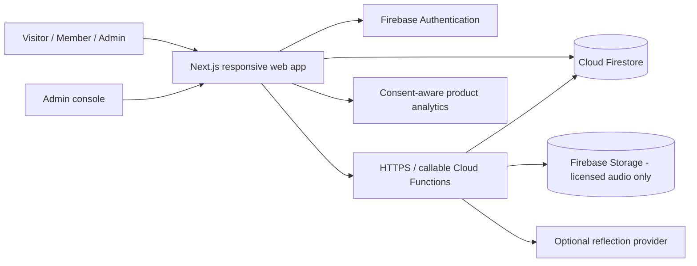

# System Architecture and Data Design

## System context

The browser renders presentation and collects input. Firebase Authentication establishes identity. Firestore Security Rules enforce ownership and role boundaries. Cloud Functions are the authority for XP, levels, achievements, streaks, subscriptions, group membership, and admin publishing. The browser never writes reward totals directly.

## Technology decisions

- **Web:** Next.js App Router, React, TypeScript, Tailwind CSS, shadcn/ui primitives with a custom ScriptType visual system.
- **Auth and persistence:** Firebase Authentication (email/password and Google), Firestore.
- **Trusted operations:** Firebase Cloud Functions (TypeScript), with App Check, authentication checks, input validation, idempotency, rate limits, and audit events.
- **Media:** Firebase Storage only for audio for which the organization has confirmed distribution rights. Prefer hosted/licensed providers where required.
- **Analytics:** consent-aware event interface; production provider chosen at deployment. Do not send verse input, journal text, email, or sensitive identifiers to analytics.
- **Hosting:** Firebase Hosting serves the Next.js static export. The App Router pages are pre-rendered; browser Firebase SDK calls handle auth, data, and callable operations. No page requires a Next.js server at request time.
- **PWA/offline:** Firebase Hosting serves `public/manifest.json` and `public/sw.js`; the worker caches the app shell, selected product routes, and static assets. Offline account sessions live in a bounded localStorage outbox and retry when connectivity returns while the app is open. This is foreground sync, not Background Sync or an IndexedDB-backed offline database.

## Firestore collections

| Collection | Document / key | Important fields | Access |
|---|---|---|---|
| `users/{uid}` | Firebase UID | `displayName`, `photoURL`, `timezone`, `createdAt`, `updatedAt`, `preferences`, `role` | Owner reads/updates allowlisted profile fields; role is server-only |
| `users/{uid}/progress/summary` | one summary | `xp`, `level`, `activeStreak`, `verseStreak`, `memoryStreak`, `lastQualifiedDate`, `weeklyGoal`, aggregate counts, `completedKeyboardStageIds`, `bestWpm`, `wordsTyped`, `perfectLessons` | Owner read; server write |
| `users/{uid}/sessions/{sessionId}` | random ID | activity/reference IDs, metrics, `completedAt`, `idempotencyKey`, reward status | Owner read; create/update through function only |
| `users/{uid}/journeys/{journeyId}` | journey ID | `status`, completed step IDs, `startedAt`, `updatedAt` | Owner read; server write |
| `users/{uid}/achievements/{achievementId}` | achievement ID | `unlockedAt`, `sourceSessionId` | Owner read; server write |
| `users/{uid}/journals/{entryId}` | random ID | `reference`, encrypted-at-rest body, timestamps, retention setting | Owner only; never exposed in group/admin query |
| `contentVerses/{verseId}` | stable content ID | `translation`, `reference`, `text`, `provenance`, `reviewStatus`, `contentVersion` | Public read for published content; staff write via admin function |
| `journeys/{journeyId}` | stable ID | title, description, ordered activity IDs, visibility, content version | Published public read; staff write via function |
| `achievements/{achievementId}` | stable ID | name, description, icon, criteria version, active | Public read; staff write via function |
| `groups/{groupId}` | random ID | name, owner UID, visibility, invite policy, moderation settings | Member-scoped read; owner/moderator write through functions |
| `groups/{groupId}/members/{uid}` | user UID | role, display alias, joinedAt, visibility preferences | member-scoped; function-controlled |
| `groups/{groupId}/challenges/{challengeId}` | random ID | dates, activity scope, goal, status | Members read; owner/admin publish through function |
| `groups/{groupId}/reports/{reportId}` | random ID | reporter UID, target, reason, status, timestamps | Reporter and authorized moderators only |
| `races/{raceId}/results/{uid}` | daily race ID and user UID | alias, server-computed WPM/accuracy, elapsed time, completion timestamp | Race callable only; client reads through callable |
| `globalRaceResults/{uid}` | Firebase UID | latest race ID, opt-in alias, server-computed WPM/accuracy, `optedIn` | Race callable only; queried by leaderboard callable |
| `entitlements/{uid}` | UID | provider, product, status, expiration, verifiedAt | Owner limited read; server write |
| `adminAudit/{eventId}` | random ID | actor UID, action, entity, timestamp, safe change summary | Admin-only read; server write |

### Data and retention rules

- Store timestamps in UTC; calculate day-based streaks using an IANA timezone from the user's profile and a server-defined day boundary.
- Use a server-generated session ID and idempotency key. A repeated completion request returns the original result, not a second reward.
- Keep detailed session history only as long as needed for user-visible progress; document and enforce a retention period before production.
- Journal deletion is immediate from the user experience and scheduled backend deletion from backups/exports per published retention policy.
- Data export/deletion workflows include owned group contributions and explain any content retained for safety/legal requirements.
- KJV reference text included in the repository must be sourced from a verified public-domain edition; record source and review date. Do not assume audio rights follow text rights.
- Minimize PII. Use aliases for group rankings, and keep email/private profile fields outside public group documents.

## Cloud Function contracts

All authenticated functions validate Firebase ID tokens; privileged functions also require App Check, role claims, bounded payload sizes, and rate limits. Errors use stable codes such as `unauthenticated`, `permission-denied`, `invalid-argument`, `already-exists`, `resource-exhausted`, and `failed-precondition`.

| Function | Request | Result / behavior |
|---|---|---|
| `completePractice` | session ID, activity ID, mode, typed-input-derived metrics, start/end timestamps, idempotency key | Recomputes/validates metrics against canonical content, applies dedupe, writes session and rewards transactionally, returns earned XP/level/achievements |
| `updateRaceSettings` | alias, global opt-in | Saves alias and consent; removes public result on opt-out |
| `submitRaceResult` | daily race ID, typed race passage, client elapsed time, alias | Validates current race passage and membership/opt-in, computes metrics on the server, saves best WPM |
| `getRaceLeaderboard` | optional current race ID | Returns global opted-in entries or an existing group's results after membership check |
| `startJourney` | journey ID | Validates published journey, idempotently creates user journey state |
| `completeJourneyStep` | journey ID, step ID, session ID | Requires eligible completion; advances progress transactionally |
| `joinGroup` | invite token | Validates expiry/capacity/moderation state; creates membership and audit event |
| `createGroupChallenge` | group ID, challenge definition | Owner/moderator only; validates date bounds and allowed content |
| `reportContent` | group ID, target, reason | Rate-limited; stores private report and sends moderation event |
| `setEntitlement` | provider receipt/event ID | Provider-signed webhook only; verifies receipt, applies idempotently |
| `publishContent` | entity/version and moderation metadata | Staff role only; writes approved, versioned published content and audit entry |
| `deleteAccountData` | confirmation token | Verifies caller, starts auditable deletion workflow and revokes sessions |

The client uses a typed repository interface so the demo adapter and Firebase adapter share UI contracts. Demo mode is an explicit, visible preview mode; it is not presented as an authenticated or durable account.

### Offline and competition boundaries

- The local practice outbox stores up to 100 pending sessions in localStorage. It is isolated per Firebase account, uses stable idempotency keys, and grants no provisional account XP. Pending sessions retry in the foreground on app startup/online events; this does not guarantee delivery if browser storage is cleared or evicted.
- Weekly-goal and sound preferences keep per-setting timestamps in a per-account outbox. Sync compares each setting's timestamp in a Firestore transaction and keeps the newer value; race alias/visibility uses its dedicated callable. Pending settings also require foreground connectivity to sync.
- The service worker only handles same-origin GET requests and limits navigation caching to app routes; Firebase requests and arbitrary navigation paths are not cached.
- Race passages and text metrics are checked by trusted functions. Race elapsed time is supplied by the client, so leaderboard timing is best-effort, not cheat-proof. Global ranking is opt-in. The app can display results for an existing group membership, but group invite creation/joining and moderation workflows are not implemented.

## Security model

- Default deny in Firestore rules; every path names authenticated ownership, membership, or staff role explicitly.
- Clients cannot write `role`, XP, level, streak, achievements, entitlement status, group membership roles, or published content.
- Use custom claims only for coarse staff roles; verify claims in both rules and Functions and audit role changes.
- Add App Check, rate limiting, abuse detection, dependency scanning, and secret management before production launch.
- Do not put Firebase Admin credentials or AI/payment provider secrets in `NEXT_PUBLIC_*` variables.
- Journal text is never included in logs, analytics, crash reports, AI prompts without an explicit user action, or admin listings.
- AI reflection is optional, requires consent per interaction, sends only the selected reference/context, and is disclosed as machine-generated.
- Community launch is gated on reporting/blocking, moderation tooling, age/privacy policy, and documented escalation procedures.

## Analytics event contract

Use an allowlisted event schema with a pseudonymous user key, timestamp, app version, consent state, and coarse properties. Initial events: `landing_cta_clicked`, `signup_completed`, `mission_started`, `practice_completed`, `journey_started`, `journey_step_completed`, `streak_qualified`, `achievement_unlocked`, `group_joined`, `challenge_joined`, `premium_checkout_started`, and `premium_entitlement_changed`.

Never include verse typed text, journal content, auth tokens, email, or raw invite tokens. Set retention and deletion policies and suppress analytics until the applicable consent/age requirements are met.

## Deployment environments

Use separate Firebase projects for local emulator, staging, and production. Keep `.env.local` untracked; document required public Firebase web config and server-only secrets in `.env.example`. Production rollout requires hosting, domain, App Check, Firebase rules/index deployment, function deployment, error monitoring, backups, and tested account deletion.
