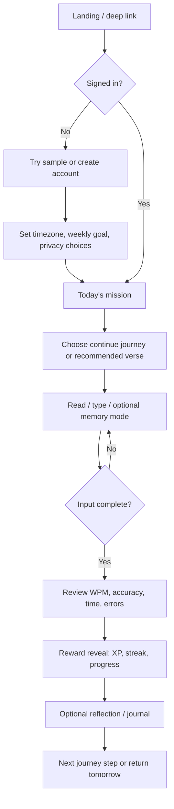

# User Flows, Page Map, and Wireframes

## Primary practice loop



## Supporting flows

### Journey
Browse journeys → inspect translation, duration, and sample → start → complete an assigned practice → unlock next step → view completion milestone. Leaving midway preserves progress; a journey can be paused without losing completed work.

### Memory and audio
Select a verse → choose visible / missing words / major words hidden / fully hidden, or audio mode → practice → see recall score separately from typing accuracy → schedule/recommend a later review. The free/premium boundary is stated before a locked mode opens.

### Community
Create/join by invite → preview group name, owner, rules, and visible profile fields → accept → choose alias/leaderboard visibility → join an opt-in challenge → report/block if needed. No private journal or full practice text appears in group feeds.

### Admin publishing
Authorized staff → create draft → set translation/provenance and ordered references → validate content and rights metadata → preview desktop/mobile → publish version → audit log. Archive does not erase user completion history.

## Page-by-page breakdown

| Route / surface | Primary purpose | Key content and actions |
|---|---|---|
| `/` | Explain and convert | Distinctive hero, sample typing interaction, how-it-works, testimonials/social proof (only verified), plan comparison, CTA |
| `/sign-in` | Establish identity | Email/password, Google, error recovery, privacy links; guest demo path |
| `/onboarding` | Personalize habit | Weekly goal, preferred reminder/timezone, optional journey, privacy and consent |
| `/app` | Start today's action | Today's Bible Mission, resume journey, streak flame, XP/level, weekly goal, recommended challenge |
| `/app/challenge/[id]` | Focused practice | Verse/reference, mode controls, typed text, caret/progress, timer/WPM/accuracy, pause/exit |
| `/app/complete/[sessionId]` | Reflect and reward | Metrics, XP/milestone motion, optional reflection, next-step CTA |
| `/app/journeys` | Choose a structured path | Journey map/list, progress, duration, translation and next step |
| `/app/journeys/[id]` | Continue a path | Chapter/verse steps, completion states, resume action |
| `/app/memory` | Recall and review | Level progression, due reviews, recall history |
| `/app/audio` | Listen and type | Playback, replay/speed, transcript access, listening/typing score |
| `/app/progress` | See growth | WPM/accuracy trends, activity calendar, chapters, memory, goals |
| `/app/community` | Encourage safely | Groups, opt-in challenges, alias-based rankings, reporting controls |
| `/app/community/groups/[id]` | Coordinate a group | Challenge status, member visibility choices, group rules, moderator/report |
| `/app/reflection` | Private practice journal | User-controlled prompts, saved entries, export/delete controls |
| `/app/settings` | Manage account | Profile/timezone, notifications, privacy, accessibility, subscription, export/delete |
| `/app/admin` | Curate product content | Role-protected drafts, journeys, daily verses, achievement/challenge CRUD, user safety queues, audit view |

## Mobile-first wireframes

### Today / app home

```text
┌──────────────────────────────┐
│ ScriptType     🔥 4    ◉ 240 │  compact header, safe-area aware
│                              │
│ TUESDAY · YOUR DAILY MISSION │  small, calm eyebrow
│                              │
│ “Your word is a lamp...”     │  large editorial verse card
│ Psalm 119:105 · KJV          │  reference and translation
│                              │
│ [ Continue today's practice ]│  one obvious primary action
│                              │
│ YOUR PATH                    │
│ John Journey   8 of 21        │  path-like segmented progress
│ ━━━━━━━━━━━○━━━━━━━━━━━━     │
│                              │
│ WEEKLY RHYTHM    3 / 5 days   │  compact goal ring / activity dots
│ ○ ● ● ○ ○ ○ ○                │
│                              │
│ Next: Recall yesterday's verse│  personalized secondary action
│ Home  Journeys  Progress  You│  thumb-zone navigation
└──────────────────────────────┘
```

### Focused typing challenge

```text
┌──────────────────────────────┐
│ ‹ Exit       JOHN 1 JOURNEY   │
│ Step 9 of 21      ━━━━━━○━━━  │
│                              │
│  In the beginning was the    │
│  Word, and the Word was with │
│  God, and the Word was God.  │  reading block, line wraps naturally
│                              │
│  In the beginning was the    │
│  Word, and the Word was with │  live character-state input surface
│  God, and the Word was God.█ │
│                              │
│  42 WPM       98% accuracy   │  fixed metric strip, announced accessibly
│                              │
│  68% COMPLETE                │
│  [ Save and leave ]           │
└──────────────────────────────┘
```

### Completion

```text
┌──────────────────────────────┐
│         Verse complete       │
│        +25 XP  ✨             │  restrained, reduced-motion aware
│                              │
│  42 WPM     98%     1:18     │
│  +4 vs avg  accuracy  time   │
│                              │
│  DAILY STREAK  4 days 🔥     │
│  Weekly rhythm: 4 / 5        │
│                              │
│  What stands out to you?     │
│  [ Reflect (optional) ]      │
│                              │
│  [ Continue John Journey ]   │
│  Back to today               │
└──────────────────────────────┘
```

## Interaction and accessibility states

- Correct/incorrect character status uses shape/underline/color, never color alone. Contrast meets WCAG AA for text and controls.
- Keep keyboard focus visible and predictable. Provide a labeled editable text field rather than requiring pointer-only character interactions.
- Announce meaningful milestones and metric summaries via a polite live region; do not announce every keystroke.
- On mobile, use the native keyboard and a scroll-stable input; prevent viewport jumps and keep submit/exit reachable.
- Provide pause/exit with a clear save/discard choice. On network failure, retain only the user's current local session until sync can succeed and explain that state.
- Support `prefers-reduced-motion`; reward animations are short, non-blocking, and never necessary to understand a state.
